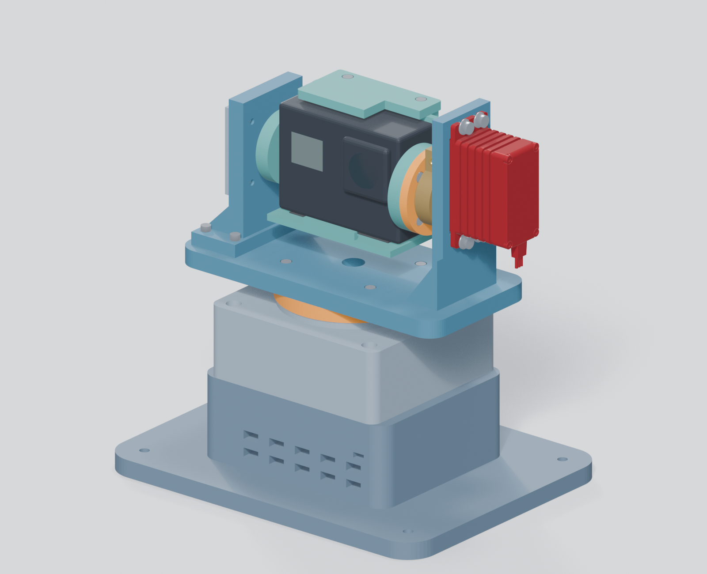

# MKS HBL388 / GoPro HERO8 双轴云台

本仓库保存 MKS-X8-HBL388 舵机、GoPro HERO8 双轴云台的 **CAD / FDM 试配原型**。不是已完成实物承载或精度验收的成品。

## 开始使用

- **[仅用正式 STL 零件的 8 批打印验证流程](mks_gimbal/STL_PRINT_VALIDATION.md)**：打印顺序、通过条件、失败处理和待填写实物记录。
- [完整中文装配说明](mks_gimbal/README.md)：机械依据、紧固件、打印姿态和安装顺序。
- [STL 打印件](mks_gimbal/stl/) / [3MF 模型](mks_gimbal/3mf/)：各 16 件。
- [Blender 总装](mks_gimbal/mks_gimbal.blend) / [Blender 爆炸图](mks_gimbal/mks_gimbal_exploded.blend)。
- [离线查看器](mks_gimbal/viewer.html)：下载仓库后本地双击；GitHub 文件页不直接运行此 HTML。
- [生成与验证代码](mks_gimbal/source/README.md)。

## 验证状态

真实舵机使用用户提供的原始 STEP / STL，不做变形或独立缩放。打印件之间用 M2.5 热熔铜套，舵机安装耳用 M3 通栓与防转螺母；传动使用真实 25T 截面构建的自打印夹紧轴套。

已完成数字网格、装配干涉、螺钉 / 工具空间、安装路径和 Pan / Tilt 各 ±90°、每 5° 的采样检查。报告与源文件哈希在 `mks_gimbal/`。

**未完成实际切片、FDM 试配、夹紧后回差、长期蠕变和承载 / 冲击验收。** 默认侧隙未夹紧 CAD 空行程约 1.7°，不能据此宣称夹紧后零回差。先小件验证，再打印大结构；不做舵机满堵转扭矩试验。

本次提交只包含 MKS 版本。MG90S 旧版 / 存档及本机临时草稿不在本次上传范围内。

引用工具和尺寸来源见 `mks_gimbal/reference/`、`mks_gimbal/source/lib/PROVENANCE.md` 和查看器库的许可文件；本仓库不额外给所有参考模型统一指定新许可。
